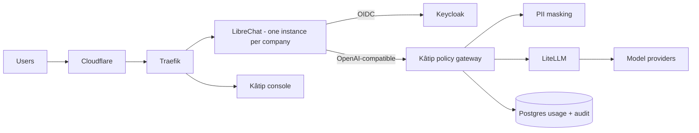

<p align="center">
  
</p>

<p align="center"><strong>Copilot değil, Kâtip.</strong><br>
An open-source AI workspace for small and medium businesses, with a governed LLM router, built on <a href="https://www.librechat.ai">LibreChat</a>.</p>

---

> **Status:** early development (Phase 0 – foundations). Not ready for production use. See [docs/TRACKER.md](docs/TRACKER.md).

## What Kâtip is

Kâtip ("scribe" in Turkish) gives a company's whole team a ChatGPT-style assistant that costs much less than Microsoft Copilot. It also keeps company data under control.

- **Chat, files, web search and agents.** These come from LibreChat, used unmodified through its official image.
- **Governed LLM router.** Every model call goes through the Kâtip policy gateway, which:
  - checks company policy and budgets;
  - masks personal data (Turkish ID numbers, IBANs, phone numbers, names) before anything leaves the platform;
  - picks a cost-effective model and escalates to premium models only when needed;
  - falls back on errors;
  - meters every token.
- **Governance console.** Company admins manage users, departments, budgets, allowed models and access rules (IP allowlist, allowed countries, MFA). Every user gets a self-service portal.
- **KVKK-ready.** Uses zero-retention model providers, keeps an audit log, and offers an optional Turkey-only region with self-hosted models.
- **Studio** (planned): a visual designer for agentic flows.

## Architecture in one picture



The full design is in [docs/DESIGN.md](docs/DESIGN.md), and per-component designs are in [docs/lld/](docs/lld/).

## Repository layout

```
apps/
  policy-gateway/   OpenAI-compatible gateway: policy, PII masking, routing, metering
  mock-llm/         OpenAI-compatible mock provider for tests and local dev
packages/
  shared/           env validation, logger (PII-safe), problem+json errors
  pii/              Turkish PII recognizers (TCKN, VKN, IBAN, phone), masking + streaming un-masking
  policy-engine/    router rules and quota math (pure functions)
infra/
  compose/          Docker Compose for local dev
  litellm/          LiteLLM configuration
docs/               design, low-level designs, ADRs, tracker
```

More apps (console, provisioner, billing bridge, Studio) arrive as the [tracker](docs/TRACKER.md) progresses.

## Getting started (development)

Requirements: Node 22 LTS, pnpm 10, Docker 24+.

```bash
pnpm install
pnpm build
pnpm test          # unit + integration tests (no Docker needed)
pnpm lint && pnpm typecheck
```

Run the gateway against the mock provider:

```bash
pnpm --filter @katip/mock-llm start &            # http://localhost:4010/v1
cp apps/policy-gateway/.env.example apps/policy-gateway/.env
pnpm --filter @katip/policy-gateway dev          # http://localhost:8080/v1
curl -s localhost:8080/v1/chat/completions \
  -H 'Authorization: Bearer sk-katip-demo-local' -H 'X-User-Email: demo@example.com' \
  -H 'Content-Type: application/json' \
  -d '{"model":"auto","messages":[{"role":"user","content":"Merhaba, TCKN 10000000146"}]}'
```

The Docker Compose stack for the platform services is described in [docs/lld/01-repo-and-deployment.md](docs/lld/01-repo-and-deployment.md) and lands with tracker task P0-03.

## Contributing

Contributions are welcome. Please read [CONTRIBUTING.md](CONTRIBUTING.md) and [CLAUDE.md](CLAUDE.md), which holds the engineering rules for humans and AI coding agents alike.

Contributors sign our CLA so Kâtip can stay dual-licensed. Report security issues privately; see [SECURITY.md](SECURITY.md).

## License

- **Kâtip modules:** [AGPL-3.0](LICENSE), with a **commercial licence** available on request. See [COMMERCIAL-LICENSE.md](COMMERCIAL-LICENSE.md).
- **Use:** free for everyone, including commercial use. If you modify Kâtip and offer it to others over a network, you must publish your changes under the AGPL, unless you hold a commercial licence.
- **LibreChat:** MIT-licensed upstream, used unmodified.
- **Trademark:** the Kâtip name and logo are trademarks (registration pending) and are not covered by the code licence.
