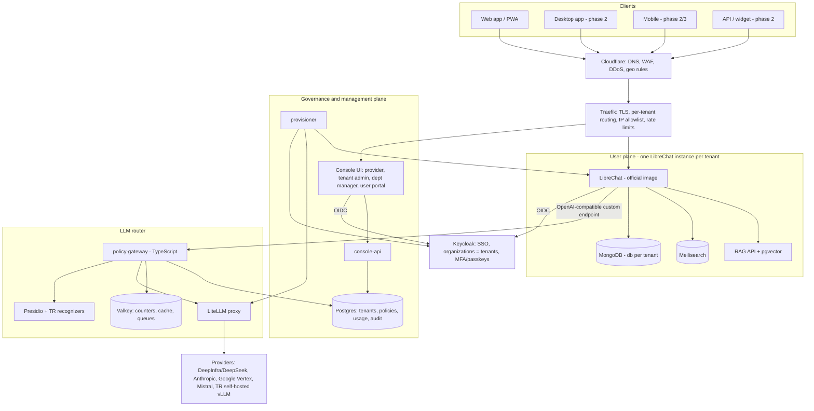

# DESIGN — Kâtip

Version 1.0 · 31 Oct 2026 · Owner: Ali Tolga Eskici

This is the developer-facing system design. Each component has a low-level design in [lld/](lld/).

## 1. Goals and non-goals

**Goals**

- An AI workspace for SMEs (1–300 users) that replaces Copilot at roughly half its price or less. Our Business tier is $8 per user/month; Copilot Business is $21, or about $9.50 inside the M365 bundles.
- Any model, through one governed router. The default is a cheap model (DeepSeek V4 Flash), with escalation to premium models.
- KVKK compliance:
  - personal-data masking before any provider call;
  - zero-retention providers only;
  - an optional Turkey-only region with domestic or self-hosted models.
- Open source (AGPL-3.0 for our modules), self-hostable, and cheap to operate with a small team.

**Non-goals (phase 1)**

- Native Office/Teams integration: phase 3.
- Our own model training.
- Kubernetes. We use Docker Compose on a few VMs until about 20 customers.
- A public API marketplace or developer portal.

## 2. Architecture

### Planes

| Plane | Components | Our code? |
| --- | --- | --- |
| User plane | LibreChat (official image), MongoDB, Meilisearch, RAG API, code-interpreter sandbox, SearXNG | Config only (librechat.yaml, env, MCP servers) |
| Governance plane | `apps/console` (UI), `apps/console-api`, `apps/provisioner`, Postgres | Yes |
| LLM router | `apps/policy-gateway`, LiteLLM, Presidio, Valkey | Gateway yes; LiteLLM and Presidio are config only |
| Phase 2 | `apps/knowledge` (MCP server), `apps/studio` + `apps/studio-runner`, connectors | Yes |

### Request path (chat)

1. The user signs in to `https://<tenant>.<domain>` (LibreChat) through Keycloak OIDC.
2. LibreChat sends the chat request to the custom endpoint **"SME AI"**: `baseURL: http://policy-gateway:8080/v1`. The request carries:
   - the per-tenant gateway key;
   - headers `X-User-Id: {{LIBRECHAT_USER_ID}}` and `X-User-Email: {{LIBRECHAT_USER_EMAIL}}`;
   - `X-Conversation-Id: {{LIBRECHAT_BODY_CONVERSATIONID}}`.
3. The gateway does the following, in order:
   1. Identifies the tenant (from the key), the user and the department.
   2. Checks policy and quota.
   3. Masks personal data (Presidio).
   4. Picks the model (router rules).
   5. Calls LiteLLM, which calls the provider with fallbacks.
   6. Streams the answer back, un-masking it.
   7. Meters usage and writes the audit record.
4. The usage ledger feeds dashboards, budgets and Lago billing.

Details: [lld/03](lld/03-policy-gateway-and-router.md).

## 3. Architecture decisions (ADRs)

| ID | Decision | Status | Why / consequence |
| --- | --- | --- | --- |
| ADR-001 | Use the **official LibreChat image**, pinned; no fork | Accepted | Cheap upgrades. All customisation goes through yaml, env, custom endpoints, MCP and OIDC |
| ADR-002 | **One LibreChat instance per tenant** (cell model), on shared databases (one Mongo database per tenant) | Accepted for phase 1 | Strong isolation: LibreChat sharing features (agents, prompts, "all users") must not leak across companies. Cost: about 0.4–0.6 GB RAM per tenant instance (verify in pilot). Revisit when upstream LibreChat tenant support matures; its docs already mention tenant placeholders |
| ADR-003 | **TypeScript policy gateway in front of LiteLLM** | Accepted | Our governance logic stays in our language; LiteLLM is a provider abstraction with fallbacks |
| ADR-004 | **Keycloak** with one realm; **Organizations = tenants**; one OIDC client per tenant instance | Accepted | Apache 2.0; brokers each customer's Entra ID or Google |
| ADR-005 | **Docker Compose on VMs** (Hetzner EU; Turkish data centre for the KVKK region) | Accepted | Simple operations for a small team; Kubernetes after about 20 customers |
| ADR-006 | **AGPL-3.0 + commercial licence** (dual licensing) for our modules; contributors sign a CLA | Accepted (31 Oct 2026) | Open source and free for everyone, including commercial use. Anyone who modifies the code and hosts it for others must publish their changes, which protects our hosting and services revenue. Companies that won't publish changes (OEMs, integrators) can buy a commercial licence. The CLA gives us the right to relicense contributions. Lawyer to review the licence notice and CLA text |
| ADR-007 | Secrets in **SOPS + age** encrypted env files; OpenBao later for per-tenant keys | Accepted | Simplest secure option on plain VMs |
| ADR-008 | **Traefik** behind **Cloudflare** as gateway and ingress | Accepted | Docker labels, automatic TLS, IP allowlist and rate-limit middlewares |
| ADR-009 | Expose company knowledge, deep research and Studio flows to LibreChat as **MCP servers** | Accepted (phase 2) | No LibreChat changes; per-user identity via `{{LIBRECHAT_USER_*}}` headers |
| ADR-010 | Usage metering in **our own Postgres ledger** (+ Valkey counters); **Lago** only for invoicing | Accepted | OpenMeter needs Kafka and ClickHouse, which is too heavy for phase 1 |
| ADR-011 | Default model **DeepSeek V4 Flash via zero-retention providers** (DeepInfra); the DeepSeek first-party endpoint is blocked | Accepted | About $0.27–0.32 per typical user per month; OpenRouter lists DeepSeek's own endpoint as "may train" |

## 4. Tenancy model

- **Tenant** = one customer company. It has:
  - a slug (`acme`) and a subdomain (`acme.<our-domain>`), with an optional custom domain;
  - one LibreChat instance and one Mongo database (`lc_acme`);
  - one Keycloak organization and OIDC client;
  - one LiteLLM team;
  - one Lago customer;
  - one gateway key.
- **Departments** sit inside a tenant: budgets and policies can be set per department.
- **Users** belong to one tenant. Their tier (Starter / Business / Studio) is a seat assignment. Their role is one of `user`, `dept_manager`, `tenant_admin`.
- **Provider admins** (us) are Keycloak users in a separate `provider` organization with the `provider_admin` role.

## 5. Tiers, quotas and prices (what the code must enforce)

Prices are USD per user per month on an annual plan; monthly billing costs 20% more.

| Plan code | Price | Standard tokens (pooled) | Premium tokens (pooled) | Deep-research runs (pooled) | Files | Features |
| --- | --- | --- | --- | --- | --- | --- |
| `community` | 0 (self-host) | – | – | – | – | Bring your own keys; no quotas enforced unless configured |
| `starter` | 6 | 4M | 0 | 10 | 1 GB | Chat, files, web search, router, budgets |
| `business` | 8 | 6M | 0.5M | 40 | 5 GB | + knowledge connectors, agents, governance, PII masking, SSO |
| `studio` | 14 | 10M (+ flow usage) | 1M | 60 | 10 GB | + Studio (builder seat) |
| `kvkk_addon` | +7 | – | – | – | – | TR region, domestic model routing |

How quotas work:

- **Pooled** means summed over the tenant's seats per calendar month. For example, 8 Business + 2 Studio seats give 8×6M + 2×10M = 68M standard tokens.
- **Overage** is $1.00 per 1M standard tokens, $6.00 per 1M premium tokens and $5 per 100 deep-research runs.
- **At 100% of quota** the tenant setting decides what happens:
  - `block`;
  - `downgrade` (premium → standard, standard → cheapest model);
  - `overage` (allowed and billed).
- **"Standard" models:** the router's cost-effective pool (DeepSeek V4 Flash, GLM-5.3 Flash, Gemma 4 26B, gpt-oss).
- **"Premium" models:** Claude Sonnet 5.5, Gemini 4 Argon, GPT-5.6 Terra and similar. Model-to-class mapping lives in the `model_catalog` table, not in code.

## 6. Technology stack

| Area | Choice | Licence |
| --- | --- | --- |
| Chat app | LibreChat (official image), MongoDB, Meilisearch, RAG API + pgvector | MIT / SSPL (DB only) / MIT |
| Identity | Keycloak (Organizations, passkeys/WebAuthn) | Apache-2.0 |
| Ingress | Cloudflare (Pro) → Traefik | – / MIT |
| Gateway | Fastify (TypeScript) | – |
| LLM proxy | LiteLLM (self-built pinned image) | MIT core |
| PII | Microsoft Presidio analyzer + anonymizer, with custom TR recognizers | MIT |
| Data | PostgreSQL 16 + pgvector, Valkey 8, SeaweedFS (S3 API) | PostgreSQL / BSD-3 / Apache-2.0 |
| Jobs | BullMQ on Valkey | MIT |
| Billing | Lago (unmodified) + our invoice bridge → Paraşüt (e-Fatura; decision open) | AGPL-3.0 |
| Web search | SearXNG (unmodified) | AGPL-3.0 |
| Observability | OpenTelemetry, Prometheus, Grafana, Loki (unmodified); Langfuse in production | Apache / AGPL / MIT core |
| Studio (phase 2) | React Flow, LangGraph.js, BullMQ | MIT |
| Knowledge (phase 2) | Docling, BGE-M3 embeddings (via gateway), pgvector, OpenFGA | MIT / Apache |
| Desktop / mobile (phase 2/3) | Tauri, Capacitor | MIT / Apache |

## 7. Security model (summary; details in lld/02 and lld/10)

**Admin side**

- Nothing is public except HTTPS through Cloudflare.
- SSH and admin UIs go only through Tailscale or Cloudflare Access.
- SSH by key only.

**Users**

- SSO through the customer's IdP (Entra ID or Google) where possible.
- Otherwise Keycloak accounts with a passkey or TOTP, which is mandatory.

**Per-tenant access rules**, set in the console and enforced by Traefik middleware and the gateway:

- IP allowlist;
- allowed countries (Cloudflare);
- required MFA;
- session length.

**Data**

- Personal data is masked before leaving the platform.
- Only zero-retention providers are used.
- Encryption in transit and at rest.
- An append-only audit log.

**Supply chain**

- Pinned images, Renovate, Trivy in CI, and our own LiteLLM image build.

## 8. Environments and sizing

| Env | Where | Size (estimate) |
| --- | --- | --- |
| dev (local) | developer laptop | 32 GB RAM recommended; 16 GB without Presidio and Keycloak |
| dev/test shared | Hetzner AX42 (8 cores, 64 GB) | about 28 GB for dev + test stacks |
| pilot (≤200 users) | 1 × 8 vCPU / 32 GB / 250 GB SSD + Storage Box backups | + about 0.5 GB per tenant instance |
| production (≤1,000 users) | 3 VMs: app + gateway, databases, workers | see lld/01 |
| KVKK region | Same topology in a Turkish data centre + GPU server for vLLM | – |

## 9. Open questions

- [x] ADR-006 confirmed: AGPL-3.0 + commercial licence, CLA for contributors (31 Oct 2026).
- [ ] e-Fatura provider: Paraşüt first, or a direct integrator (Nilvera / İzibiz).
- [ ] Card payment provider for subscriptions (iyzico / PayTR adapter for Lago).
- [ ] Domestic LLM partner and Turkish GPU hosting quote (KVKK add-on cost assumption: $4 per user).
- [ ] Measure LibreChat instance RAM per tenant in the pilot (ADR-002 cost).
