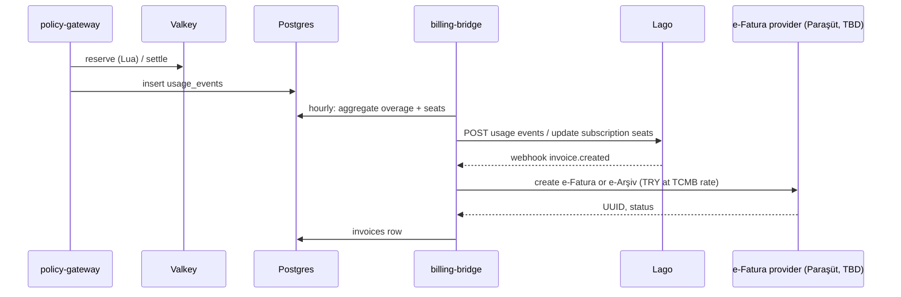

# LLD-06 — Usage, quotas and billing

## 1. Flow

## 2. What is billed

| Item | Source | Lago model |
| --- | --- | --- |
| Seats per plan | `seats` | Subscription plan with per-unit charge (quantity = seats); annual or monthly |
| Overage standard tokens | `usage_events` where `overage = true` and `class = standard` | Metered charge, `$1.00 / 1M` |
| Overage premium tokens | same, `class = premium` | `$6.00 / 1M` |
| Extra deep-research runs | `source = research` beyond quota | `$5 / 100 runs` |
| Add-ons | KVKK (+$7 per seat), dedicated instance ($149/month) | Add-on charges |

The billing-bridge sends **aggregated hourly** usage to Lago as events with the following fields:

- `transaction_id = <tenant>-<hour>-<class>`, so retries are idempotent;
- `external_subscription_id`;
- `code`;
- `properties.tokens`.

Verify the field names against the Lago API for the pinned version.

## 3. Currency and invoicing (Turkey)

- The list price is in USD. Turkish customers are invoiced in TRY at the CBRT/TCMB selling rate of the invoice date. The rate is fetched by the daily job (LLD-07 §2c) from the TCMB XML and stored in `fx_rates`, with the bank's own date, as published. The first rate for a date is kept. The feed only changes on working days, so an invoice dated on another day needs the last rate before it, and which published date applies to which invoice date needs confirming with the accountant.
- **e-Fatura vs e-Arşiv:** check whether the customer's VKN is a registered e-Fatura user, via the provider's API.
  - Registered → e-Fatura.
  - Otherwise → e-Arşiv.
- **Provider:** Paraşüt first (decision open, see Building Blocks doc). Hide it behind the interface `EInvoiceProvider { createInvoice(), getStatus(), cancel() }` so Nilvera or İzibiz can replace it later.
- **Before automation:** for the first 10–20 customers, the bridge produces a draft and finance issues it manually on the GİB portal. Feature flag `EINVOICE_MODE = manual|parasut`.

## 4. Payments

Lago supports Stripe out of the box. For Turkish cards, a `PaymentProvider` adapter (iyzico or PayTR; decision open) handles:

- card storage (tokenised by the provider);
- recurring charges on Lago `invoice.created`;
- dunning (3 retries, then tenant suspension warning).

Bank transfer (havale/EFT) is allowed for annual plans, with manual reconciliation in the console.

## 5. Quota entitlements

`tenant_limits[month]` = Σ(seats × plan quota) + purchased packs. It is recomputed:

- when seats change;
- when a pack is bought;
- on the 1st of the month at 00:00 UTC.

The gateway reads limits through a Valkey cache (LLD-03 §6).

## 6. Margin dashboard (provider)

For each tenant and month:

- revenue: seats + overage;
- provider cost: Σ `cost_usd_micro`;
- hosting allocation: tenant instance + shared share;
- gross margin.

Alert when a tenant's margin falls below 30%.

**Built so far (P1-47), before the billing bridge.** The console's *Usage and margin* screen (`/provider/usage`), `GET /api/v1/admin/margin?month=yyyy-mm` and its CSV, `/admin/margin/export`. One calendar month in UTC, this one by default. Money is micro-USD throughout and shown in USD.

| Shown | From |
| --- | --- |
| Seat revenue | `seats.quantity` × the plan's price, from `plans`: the version in force by the month's end, or version 1 for a month before any. `monthly_price_usd_micro` when the company's latest `subscriptions` row started by then says `monthly`, otherwise `price_usd_micro` (the annual price per month) |
| Add-ons | The KVKK add-on, when `tenants.kvkk_addon`: all seats × the `kvkk_addon` plan's price, by the same cycle |
| Overage | Σ `usage_events.price_usd_micro` where `overage` |
| Provider cost | Σ `usage_events.cost_usd_micro` |
| Margin, margin % | Revenue − cost; % of revenue, to one decimal. Flagged under 30%, or with cost and no revenue |
| Platform total | The sum of the companies |
| Cost by model | Σ `cost_usd_micro` by `usage_events.model_id`, most expensive first, with its share |

How it counts:

- **One source.** Usage comes from `usage_events` only. It's the one table with the price and the overage flag, and `usage_daily` holds cost too, so using both would count it twice.
- **Months.** From the first instant of the month in UTC to the first of the next, as `usage_daily`'s days are.
- **By company.** Every event counts to its `tenant_id`, whoever the person was, so file search's nil user counts too. After a fallback, `model_id` is the model that answered, so that's the one charged.
- **Seats without usage** still count: a company appears for a month it existed in (`tenants.created_at`) and wasn't deleted before, from the last `tenant.delete` in its audit log. A suspended company still counts. A month is a whole month; there's no proration.
- **Deleted and purged companies** keep their row, so their history stays under their slug. Usage for an id with no row shows the id.

**Who sees it.** Provider admins only: every company role gets 403, its own admin included. The console's database role still can't read `cost_usd_micro`, `price_usd_micro` or any price. Instead two `SECURITY DEFINER` functions, `provider_margin(date)` and `provider_model_cost(date)` (`packages/db` `rls.ts`), return the month's sums and nothing per event, and only `katip_console` may run them. They refuse to run while `app.tenant_id` is set, which every company route sets, so a company's route can't reach them by mistake. That guard is against mistakes, not against code written to get round it. We chose this over giving console-api the provider role's login, which bypasses row-level security and can read everything.

**Not yet.** Revenue is our list price, not what was invoiced, and the screen and the CSV both say so (`basis: list_price`). When the billing bridge (P1-37) records invoices, the invoiced amounts replace list price in the store's `providerMargin`, and `basis` becomes `invoiced`. Until then:

- `seats` holds only today's seats, so every month counts the seats a company has now;
- the gateway records the provider's cost as the list price (`price_usd_micro = cost_usd_micro`) until prices are set (P1-36), so overage shows no margin of its own;
- the dedicated instance ($149/month) has nothing in the data model to read, so it isn't counted;
- hosting allocation and fixed platform costs aren't defined anywhere, so they aren't included, and the screen says so;
- the 30% is a flag on the screen, not an alert anyone is sent.

## 7. Acceptance criteria

- Replaying a usage hour twice does not double-bill (idempotent transaction ids).
- Seat change mid-period: Lago prorates per configuration, and the console shows the next invoice estimate.
- A test invoice reaches the Paraşüt sandbox (or a manual draft PDF in manual mode) with the TRY amount and the rate used.
- Monthly reconciliation report: Σ usage_events matches Lago billed overage within 0.1%.
