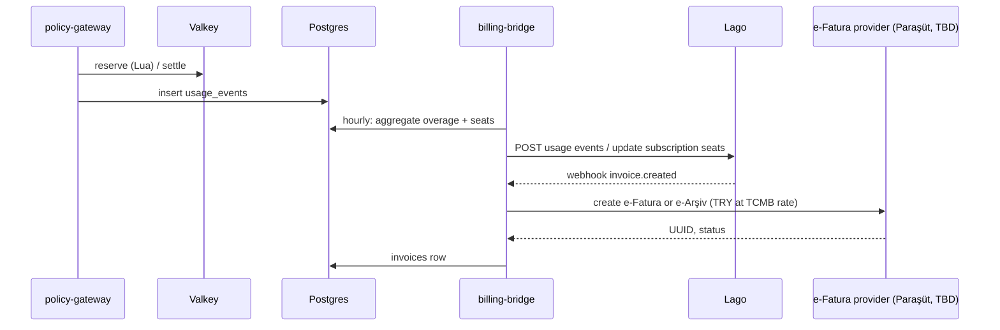

# LLD-06 — Usage, quotas and billing

## 1. Flow

## 2. What is billed

| Item | Source | Lago model |
| --- | --- | --- |
| Seats per plan | `seats` | Subscription plan with per-unit charge (quantity = seats); annual or monthly |
| Overage standard tokens | `usage_events` where `overage = true` and `class = standard` | Metered charge, `$1.00 / 1M` |
| Overage premium tokens | same, `class = premium` | `$6.00 / 1M` |
| Extra deep-research runs | `source = research` beyond quota | `$5 / 100 runs` |
| Add-ons | KVKK (+$7 per seat), dedicated instance ($149/month) | Add-on charges |

The billing-bridge sends **aggregated hourly** usage to Lago as events with the following fields:

- `transaction_id = <tenant>-<hour>-<class>`, so retries are idempotent;
- `external_subscription_id`;
- `code`;
- `properties.tokens`.

Verify the field names against the Lago API for the pinned version.

## 3. Currency and invoicing (Turkey)

- The list price is in USD. Turkish customers are invoiced in TRY at the CBRT/TCMB selling rate of the invoice date. The rate is fetched daily from the TCMB XML and stored in `fx_rates`; confirm the rule with the accountant.
- **e-Fatura vs e-Arşiv:** check whether the customer's VKN is a registered e-Fatura user, via the provider's API.
  - Registered → e-Fatura.
  - Otherwise → e-Arşiv.
- **Provider:** Paraşüt first (decision open, see Building Blocks doc). Hide it behind the interface `EInvoiceProvider { createInvoice(), getStatus(), cancel() }` so Nilvera or İzibiz can replace it later.
- **Before automation:** for the first 10–20 customers, the bridge produces a draft and finance issues it manually on the GİB portal. Feature flag `EINVOICE_MODE = manual|parasut`.

## 4. Payments

Lago supports Stripe out of the box. For Turkish cards, a `PaymentProvider` adapter (iyzico or PayTR; decision open) handles:

- card storage (tokenised by the provider);
- recurring charges on Lago `invoice.created`;
- dunning (3 retries, then tenant suspension warning).

Bank transfer (havale/EFT) is allowed for annual plans, with manual reconciliation in the console.

## 5. Quota entitlements

`tenant_limits[month]` = Σ(seats × plan quota) + purchased packs. It is recomputed:

- when seats change;
- when a pack is bought;
- on the 1st of the month at 00:00 UTC.

The gateway reads limits through a Valkey cache (LLD-03 §6).

## 6. Margin dashboard (provider)

For each tenant and month:

- revenue: seats + overage;
- provider cost: Σ `cost_usd_micro`;
- hosting allocation: tenant instance + shared share;
- gross margin.

Alert when a tenant's margin falls below 30%.

## 7. Acceptance criteria

- Replaying a usage hour twice does not double-bill (idempotent transaction ids).
- Seat change mid-period: Lago prorates per configuration, and the console shows the next invoice estimate.
- A test invoice reaches the Paraşüt sandbox (or a manual draft PDF in manual mode) with the TRY amount and the rate used.
- Monthly reconciliation report: Σ usage_events matches Lago billed overage within 0.1%.
