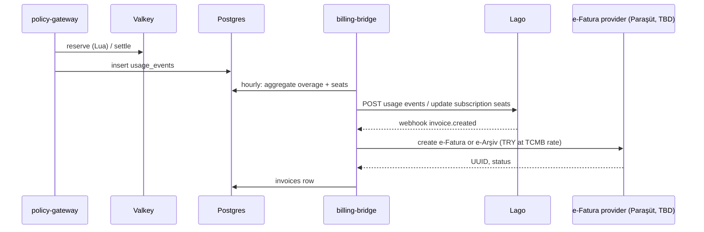

# LLD-06 — Usage, quotas and billing

## 1. Flow

## 2. What is billed

| Item | Source | Lago model |
| --- | --- | --- |
| Seats per plan | `seats` | Subscription plan with per-unit charge (quantity = seats); annual or monthly |
| Overage standard tokens | `usage_events` where `overage = true` and `class = standard` | Metered charge, `$1.00 / 1M` |
| Overage premium tokens | same, `class = premium` | `$6.00 / 1M` |
| Extra deep-research runs | `source = research` beyond quota | `$5 / 100 runs` |
| Add-ons | KVKK (+$7 per seat), dedicated instance ($149/month) | Add-on charges |

The billing-bridge sends **aggregated hourly** usage to Lago as events with the following fields:

- `transaction_id = <tenant>-<hour>-<class>`, so retries are idempotent;
- `external_subscription_id`;
- `code`;
- `properties.tokens`.

Verified against `getlago/api:v1.55.0` (P1-36): `POST /api/v1/events` takes `{ event: { transaction_id, external_subscription_id, code, timestamp, properties } }`. Lago refuses a `transaction_id` it already has for that subscription with `422 { transaction_id: ["value_already_exist"] }`, whatever the amount, so an event can never be corrected under its own id: see §2.2.

### 2.1 Lago as deployed (P1-36)

- **Containers** (`infra/compose/billing.yml`, installed by `pnpm dev:up`): `lago-api` (runs Lago's migrations, then the API), `lago-worker` (Sidekiq), `lago-clock` (billing schedule), `lago-db`, `lago-redis`. No UI (`getlago/front`) and no PDF service: nothing needs them yet, and Lago's PDFs are off (`LAGO_DISABLE_PDF_GENERATION`), as invoices in TRY are ours (P1-38). Lago's organization and API key are made at its start from `LAGO_ORG_*`, with a generated key.
- **Images:** `getlago/api:v1.55.0` (AGPL-3.0) for the API, worker and clock; `getlago/postgres-partman:15.0-alpine` pinned by digest (image MIT; PostgreSQL and pg_partman under the PostgreSQL licence); our pinned `valkey/valkey` (BSD-3) as its Redis. Lago's own compose file uses `redis:7-alpine`, unpinned, and Redis 7.4 on isn't open source, so it isn't used.
- **Own database and Redis.** Lago's migrations need the `pg_partman` extension, which our Postgres image lacks and only a superuser could add, and Sidekiq on our Valkey would need its password, which opens every company's quota counters. Apart, Lago can be upgraded and restored on its own, and a heavy billing query can't slow the gateway.
- **Provider-only.** Lago is on its own network, `<project>_billing`, which is `internal`: no published port, no Traefik route, and no way out to the internet. Only billing-bridge is on it and on `backend`. Lago's analytics, sign-up and Sidekiq web page are off. `pnpm dev:up`'s isolation step checks all of this, and that Lago's API refuses a call without its key.
- **AGPL.** Lago runs unmodified, in its own containers, and our code talks to it over HTTP. Nothing of Lago is copied into or linked with our modules, so their dual licence (ADR-006) is unaffected. If we ever modify Lago and let others use it over a network, AGPL §13 requires offering them our modified source; running it unmodified, for the provider only, asks nothing of us beyond keeping its licence notices.
- **Memory** (measured idle by two runs of `pnpm test:lago`, 4 Nov 2026, WSL2): API 465–544 MiB, worker 353–357 MiB, clock 338–339 MiB, Postgres 104–129 MiB, Valkey 4 MiB: **about 1.3–1.4 GiB** per platform. billing-bridge: 22 MiB. Lago is healthy 48–53 s after start from empty volumes.
- **Catalog**, created by `billing-bridge setup` through Lago's API, once, and then only compared: a difference stops setup, as a price change is the owner's (runbook `billing.md`).

  | Lago object | Code | From | Lago model |
  | --- | --- | --- | --- |
  | Plan | `katip_monthly` | – | monthly, calendar periods, no base fee, USD |
  | Seats per plan | `seats_starter`, `seats_business`, `seats_studio` | `plans.monthly_price_usd_micro` ($7.20, $9.60, $16.80) | recurring `sum_agg` of `seats`; standard charge, prorated, in advance |
  | KVKK add-on | `kvkk_seats` | `plans` row `kvkk_addon` ($8.40 monthly) | as seats; units = all the company's seats while `tenants.kvkk_addon` |
  | Overage standard | `standard_tokens` | `billing.overage.standard` ($1.00/1M) | `sum_agg` of `tokens`; $0.000001 per token, in arrears |
  | Overage premium | `premium_tokens` | `billing.overage.premium` ($6.00/1M) | as above, $0.000006 per token |

  Seats are metrics rather than Lago add-ons or fixed charges: changing a fixed charge's units per subscription is a paid Lago feature (`403 feature_unavailable` on the open-source edition), and add-ons are one-off. A seat change is an event with the difference. Not created, for want of a rule (§8): the annual plan, research runs, and the dedicated instance.

### 2.2 billing-bridge (P1-37)

`apps/billing-bridge`: a small service that runs at start and then every hour, plus a CLI in the same image (`setup`, `attach`, `run`, `reconcile`). It has its own Postgres role, `katip_billing`, bound by RLS: it works one company at a time in that company's context, reads only seats, the subscription row and the token and overage columns of `usage_events` (never `cost_usd_micro`), and can't delete.

- **Which companies.** Only active ones with `subscriptions.lago_subscription_id` set, by `billing-bridge attach`. Nothing attaches a company by itself; `pnpm dev:up` attaches the dev companies as test customers with made-up addresses. Customer `external_id` = slug, subscription `external_id` = `<slug>-monthly`.
- **Overage.** Tokens (input + output) of `usage_events` with `overage = true`, per UTC hour and quota class. As in the gateway's quota (LLD-03), `premium` is premium, and `standard`, `tr` and `embedding` count as standard. An hour goes `grace_minutes` (10) after it ends.
- **Postgres is the source of truth.** Each run works out each hour's total from `usage_events`, subtracts what `billing_usage_sent` says was sent, and sends the difference. The first event of an hour has the LLD's id; usage arriving later for a sent hour (the gateway's Valkey outbox can hold events back) goes as `<tenant>-<hour>-<class>-<n>`, for the difference. A row is written `pending` before its event goes and marked `sent` after; a pending row is sent again under its own id, and Lago's duplicate answer counts as sent. So a replay, a crash or a Lago error in the middle of a run neither loses usage nor bills it twice. Up to `lookback_days` (35) back.
- **Which invoice.** While an hour's month is open, its event is dated in that hour. Once the month is over, Lago may have invoiced it and would ignore an event dated then, so it's dated now and goes on the current month's invoice. The month's last hour always does.
- **Seats** sync on every run: each change of `seats` (and of the KVKK add-on) goes as the difference, `<tenant>-seats_<plan>-<n>`, recorded in `billing_seat_sent`. With `seats_in_advance` (default true), Lago invoices a seat added mid-month prorated for the rest of the month, and a seat removed is not refunded and is gone from the next month (checked on Lago v1.55.0).
- **Reconciliation** (`billing-bridge reconcile`): for the current month, overage in `usage_events` against what was sent for the same hours (exact), and what was sent into Lago's current period against Lago's `current_usage` (within 0.1%). Past months aren't compared yet.
- The quota and gateway paths are unchanged.

## 3. Currency and invoicing (Turkey)

- The list price is in USD. Turkish customers are invoiced in TRY at the CBRT/TCMB selling rate of the invoice date. The rate is fetched by the daily job (LLD-07 §2c) from the TCMB XML and stored in `fx_rates`, with the bank's own date, as published. The first rate for a date is kept. The feed only changes on working days, so an invoice dated on another day needs the last rate before it, and which published date applies to which invoice date needs confirming with the accountant.
- **e-Fatura vs e-Arşiv:** check whether the customer's VKN is a registered e-Fatura user, via the provider's API.
  - Registered → e-Fatura.
  - Otherwise → e-Arşiv.
- **Provider:** Paraşüt first (decision open, see Building Blocks doc). Hide it behind the interface `EInvoiceProvider { createInvoice(), getStatus(), cancel() }` so Nilvera or İzibiz can replace it later.
- **Before automation:** for the first 10–20 customers, the bridge produces a draft and finance issues it manually on the GİB portal. Feature flag `EINVOICE_MODE = manual|parasut`.

## 4. Payments

Lago supports Stripe out of the box. For Turkish cards, a `PaymentProvider` adapter (iyzico or PayTR; decision open) handles:

- card storage (tokenised by the provider);
- recurring charges on Lago `invoice.created`;
- dunning (3 retries, then tenant suspension warning).

Bank transfer (havale/EFT) is allowed for annual plans, with manual reconciliation in the console.

## 5. Quota entitlements

`tenant_limits[month]` = Σ(seats × plan quota) + purchased packs. It is recomputed:

- when seats change;
- when a pack is bought;
- on the 1st of the month at 00:00 UTC.

The gateway reads limits through a Valkey cache (LLD-03 §6).

## 6. Margin dashboard (provider)

For each tenant and month:

- revenue: seats + overage;
- provider cost: Σ `cost_usd_micro`;
- hosting allocation: tenant instance + shared share;
- gross margin.

Alert when a tenant's margin falls below 30%.

## 7. Acceptance criteria

- Replaying a usage hour twice does not double-bill (idempotent transaction ids).
- Seat change mid-period: Lago prorates per configuration, and the console shows the next invoice estimate.
- A test invoice reaches the Paraşüt sandbox (or a manual draft PDF in manual mode) with the TRY amount and the rate used.
- Monthly reconciliation report: Σ usage_events matches Lago billed overage within 0.1%.

## 8. Open for the owner (P1-36/P1-37)

Nothing here was decided by the build: each is left out, or set to a default that `katip.config.yaml` can change.

- **Annual plan.** "USD per user per month on an annual plan" doesn't say whether it is invoiced yearly in advance ($72/$96/$168 per seat) or monthly. In Lago's open-source edition one plan can't bill seats yearly and overage monthly (`bill_charges_monthly` moves seats to monthly too), so this needs a choice, maybe two subscriptions. Not created; `attach` refuses an annual company.
- **Research runs** ($5 per 100). What counts as a run (a `usage_events` row with `source = research`, or one research job of many calls), whether a started 100 is charged in full or pro rata, and whether research tokens also count as token overage. Not created, and nothing records research runs against `tenant_limits.research_runs` yet.
- **Dedicated instance** ($149/month). Whether the monthly +20% applies, its annual price, and where it's recorded: no table says which company has one. Not created.
- **Defaults to confirm:** seats in advance, prorated up, no refund down (`seats_in_advance: true`); overage pro rata per token, not per started million; overage from all models of a class, `tr` and embeddings as standard, as the quota counts; an event that crosses the quota limit is overage in full (the gateway's rule); usage reaching the bridge after its month ends goes on the next invoice.
- **Taxes** (KDV), invoice numbering, grace period and net payment terms: none set in Lago. With e-Fatura (P1-38).
- **A company suspended or deleted**: its Lago subscription is left as it is; the bridge skips it. Whether to terminate it, and what the last invoice holds.
- **Lago's own UI**: not deployed. If wanted, only through Tailscale or Cloudflare Access, like Keycloak's admin (DESIGN §7).
- **Lago's backups**: its database holds the invoices, and isn't in `dev:deploy`'s copies or any backup yet (P1-42).
