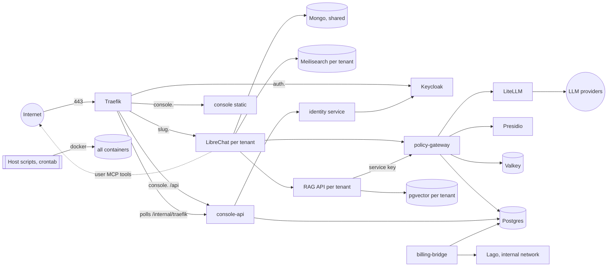

# Threat model — Kâtip

Version 1 · 4 Nov 2026 · Tracker P1-46 · Reviewed against commit `27a381e` (`main` after batch 5), plus the fix in this branch.

This is written from the code, not from the plans. Each control says where it lives. **Verified** means the code or config was read for this review, or a check was run. **Inferred** means it follows from a version number, upstream documentation or how a component usually behaves, and wasn't confirmed here. Inferred items are good first targets for the pentest ([pentest-scope.md](pentest-scope.md)).

Severity is for a production install with real customers, on the code as it is today: **Critical** (one step to cross tenants or take the platform), **High** (crosses a tenant boundary or exposes secrets with one precondition), **Medium** (needs an earlier compromise, or limits damage less than designed), **Low** (defence in depth, hygiene).

## 1. Summary

### Findings from this review, most severe first

| # | Finding | Severity | Status |
| --- | --- | --- | --- |
| F1 | `auth.<domain>` routes all of Keycloak to the internet, including `/admin` and the `master` realm, where the bootstrap admin logs in (`infra/traefik/dynamic/routes.yml:7-11`, `infra/compose/platform.yml:70-71`) (V). Inferred: that admin has a password and no MFA, as `keycloak.mjs` sets up only the tenant realm's flow. LLD-02 §7 says the admin console is Tailscale-only | High (before any internet-facing install) | Open. Fix: route only `/realms/<realm>/` and `/resources/` publicly; a second router for `/admin` and `/realms/master` with an `ipAllowList` of the Tailscale range |
| F2 | Mailpit is routed at `mailpit.<domain>` on every install, whatever the domain (`routes.yml:12-16`). Every invite email, with its set-password link, would be readable by anyone on a non-localhost install | High (before any internet-facing install) | Open. Fix: render the Mailpit router only when `base_domain` is `localhost`, as P0-22's profiles would |
| F3 | Mongo 7.0.16 is shared by every tenant and reachable from each tenant's LibreChat. Inferred from the version: CVE-2025-14847 ("MongoBleed", unauthenticated memory read through zlib-compressed messages, fixed in 7.0.28) affects it. One tenant's LibreChat broken into could read memory holding other tenants' data and logins. Trivy doesn't see it: it reads Mongo's packages, not its binary | High (inferred) | Open. Fix: pin `mongo:7.0.28` or later after checking MongoDB's advisory; until then, `--networkMessageCompressors snappy,zstd` |
| F4 | LiteLLM 1.79.3 has three CRITICAL CVEs fixed in 1.83.0–1.84.0 (CVE-2026-35030 OIDC cache auth bypass, CVE-2026-37004 template injection in `/prompts/test`, CVE-2026-49468 auth bypass by Host header). LiteLLM holds every provider key | High, lowered to Medium by reachability: only the gateway reaches it (`isolation.mjs:10-24`, verified on every install) | Open. Provisionally allowlisted until 18 Nov 2026 (`.trivyignore.yaml`). Fix: upgrade to ≥ 1.84.0, reviewed as CLAUDE.md §7 asks |
| F5 | The gateway's key cache named Valkey entries `gw:auth:<gateway key>`. Valkey runs with `appendonly`, so every key in use reached its append-only file and any copy of it, defeating argon2id at rest | Medium | **Fixed in this branch** (own commit): entries are named by a SHA-256 of the key (`apps/policy-gateway/src/db-stores.ts`, `ValkeyKeyCache`). A test checks no entry holds the key |
| F6 | Anyone who can write to Valkey can still forge a key cache entry: a JSON tenant with any id, PII masking `off`, under the hash of a made-up key. The gateway trusts it for 60 s (`db-stores.ts`, `ValkeyKeyCache.get`) | Medium (needs the Valkey password, held by the gateway and console-api) | Open. Fix: cache only the key's id, and read policy and status from Postgres or a signed entry |
| F7 | The gateway takes `X-User-Email` from any caller holding a tenant key, from any network (`apps/policy-gateway/src/app.ts:209-225`). LLD-02 §5 says it trusts the header only from the tenant's own network. Whoever holds the key can act as any user of that tenant | Medium (the key sits in LibreChat's environment) | Open. Fix: check the source network as LLD-02 says, or the phase 2 signed header |
| F8 | No Docker hardening on any service: no `no-new-privileges`, `cap_drop`, `read_only`, `pids_limit`, user namespaces. LLD-10 §1 asks for all of these. Third-party containers that start as root: Traefik, Postgres, Mongo, Meilisearch, Valkey, Mailpit and the RAG API (checked with `docker image inspect`) | Medium | Open. With P0-09 |
| F9 | Each tenant's Meilisearch runs with `MEILI_ENV: development` (`infra/compose/tenant.tmpl.yml:19`) | Low (it isn't routed) | Open. `production` before pilot |
| F10 | Keycloak realm has no password policy (`scripts/setup/keycloak.mjs:24-44`). OTP is forced, and brute-force protection is on | Low | Open |
| F11 | Provider admins aren't made to use WebAuthn (LLD-02 §7): they share the realm's browser flow, so OTP is enough (`keycloak.mjs:52-65`) | Medium | Open |
| F12 | console-api and the gateway find the person by the token's or header's email, not Keycloak's `sub`, and don't check `email_verified` (`apps/console-api/src/auth.ts:86-88`). Inferred: Keycloak 26's default user profile lets a user edit their own email. `duplicateEmailsAllowed: false` stops taking an email that exists in Keycloak, which every governance user has | Low (inferred) | Open. Pentest to check; fix by making email read-only for users |
| F13 | Supply chain: the LiteLLM image builds `FROM python:3.12-slim`, a tag that moves (`infra/litellm/Dockerfile:4`); existing workflows use actions by tag (`actions/checkout@v4`), not by commit | Low | Open. The new workflows pin by commit and digest |
| F14 | Our runtime images keep npm and corepack from the `node` base, which carry a CRITICAL in node-tar (CVE-2026-59873) and 14 HIGH. We never run npm in them | Low | Provisionally allowlisted until 4 Dec 2026. Fix: remove npm and corepack in the runtime stage |
| F15 | drizzle-orm 0.44.6: HIGH CVE-2026-39356, SQL injection through identifiers. Our code passes no input as identifiers: the only `sql.raw` uses constants (`apps/console-api/src/stores.ts:924-925`) | Low (verified not reachable) | Open. Upgrade to 0.45.2 |

None of these was exploited here: they come from reading code and scanning images. What was run is in §7.

### Known open items (from the tracker and LLDs), confirmed in code

| Item | Where | Severity |
| --- | --- | --- |
| Tenant secrets sit in container environments (LibreChat reads them there): `docker inspect` or `/proc/<pid>/environ` shows them | `infra/compose/tenant.tmpl.yml:116-117`, P1-71 | Medium |
| Valkey's password is on its command line, visible in `docker inspect` and the host's `ps` | `infra/compose/platform.yml:127-134`, `billing.yml:74-81` | Low |
| `LC_CREDS_KEY`/`IV` can't be rotated: LibreChat v0.8.7 has no re-encryption | LLD-10 §3, `secrets:rotate` refuses them | Medium |
| A name check timing out under `on_detector_failure: allow` (both dev tenants) sends names unmasked to the provider, with an error log only | `apps/policy-gateway/src/app.ts:237-268`, `katip.config.yaml` tenants | Medium (KVKK) |
| Images and files pass unscanned (P3-11) | `app.ts:388-399` | Medium (KVKK) |
| No monitoring or alerts (P1-43): `pii_detector_failed`, failed logins and the daily job reach nobody | – | Medium |
| No off-site backups (P1-42); the only copies are on the same disk | `.katip/backups/` | Medium |
| No SOPS (P0-06, P0-22): `infra/env/katip.env` is plaintext, mode 600 | `scripts/setup/util.mjs:219-220` | Medium |
| Host not hardened (P0-09), no Cloudflare or origin certs (P1-44), no country rules (P1-29) | – | High for production, n/a for dev |
| No LiteLLM backstop budget (P1-64): only the gateway's quota stops spending | – | Low |
| The secrets backup uses AES-256-CBC with no MAC (`openssl enc`), so a tampered file isn't detected before decrypting | `scripts/setup/secrets-backup.mjs` | Low |

## 2. System and trust boundaries

Networks (verified in compose files and `scripts/setup/steps.mjs:542-566`): `edge` (Traefik, Keycloak, console, console-api, Mailpit), `backend` (databases, gateway, LiteLLM, Presidio, identity, console-api), `<project>_t_<slug>` per tenant (its LibreChat, Meilisearch, RAG API and vector DB, plus Traefik, the gateway and Mongo), `<project>_billing` (internal: Lago and billing-bridge). Traefik, the gateway and Mongo join every tenant network, so they are the shared points between tenants.

## 3. Threats by boundary (STRIDE)

Each row: the threat, what stops it today (with the file), what doesn't, and severity. V = verified, I = inferred.

### 3.1 Internet → Traefik

| Threat | Stops it today | Gap | Sev |
| --- | --- | --- | --- |
| S: reach an admin UI | Traefik's API and metrics listen on `127.0.0.1:8080` inside its container (`infra/traefik/traefik.yml:20-21`); `isolation.mjs:218-226` checks tenants can't reach it (V) | Keycloak `/admin` and `master` realm are public (F1); Mailpit public (F2) (V) | High |
| T: read `/internal/traefik` (every company's host and allowlist) through the public route | The console-api router matches only `PathPrefix(/api)` (`routes.yml:24-29`); `isolation.mjs:178-183` checks it from Traefik (V) | Path tricks (`/api/../internal`, encoded dots) rely on Traefik's path sanitising (I) | Low |
| D: flood login | LibreChat routes carry `ratelimit-user` (120/s avg) (`apps/console-api/src/access.ts:129`), Keycloak brute-force protection (`keycloak.mjs:32`) (V) | No rate limit on `auth.` or `console.` routes; no Cloudflare yet (P1-44) | Medium |
| I: IP allowlist bypass | Traefik `ipAllowList` per tenant, polled from console-api, failing closed with 404 when it has no answer (`access.ts:104-138`) (V) | Uses the socket's address. Behind Cloudflare that is Cloudflare's, so the allowlist needs `forwardedHeaders.trustedIPs` and an `ipStrategy` first (P1-44) (V: neither is configured) | High at go-live, n/a in dev |
| I: weak TLS, missing headers | HSTS, nosniff, frame deny on console and tenant routes (`infra/traefik/dynamic/middlewares.yml:6-13`); console CSP (`apps/console/nginx.conf.template`) (V) | `auth.` route has no `secure-headers` (Keycloak sets its own (I)); TLS options are Traefik's defaults | Low |

### 3.2 Tenant LibreChat → gateway, Mongo, Meilisearch, RAG

The isolation checks (`scripts/setup/isolation.mjs`, run by every `pnpm dev:up`) cover each row marked "checked"; they try for real, both ways, with each tenant's own credentials.

| Threat | Stops it today | Gap | Sev |
| --- | --- | --- | --- |
| E: reach platform internals (Valkey, Postgres, LiteLLM, Presidio, identity, Keycloak's port, console-api, Lago) | Not on the tenant's network; checked (`isolation.mjs:10-24, 203-211`) (V) | – | – |
| I: read another tenant's Mongo database | One login per tenant, limited to its database; checked (`isolation.mjs:228-240`) (V) | Mongo itself is shared and reachable: F3 (MongoBleed, I); a root password brute force (random, long: I) | High |
| I: another tenant's search or files | One Meilisearch, RAG API and vector DB per tenant, own keys; checked (`isolation.mjs:242-286`) (V) | – | – |
| S: act as another tenant at the gateway | Tenant comes from the key, argon2id (`db-stores.ts`, `findTenantByKey`); user looked up within it; checked (`isolation.mjs:294-299`) (V) | Within one tenant, any key holder can be any user (F7) | Medium |
| E: RAG service key used for chat | Service keys allow embeddings only (`app.ts:216-218`); checked (V) | – | – |
| I: a user reads a colleague's files within one company | LibreChat checks file ownership in Mongo (I) | The RAG API accepts any token signed with the tenant's `JWT_SECRET`, which also signs LibreChat's own session tokens, and lists every file it holds (LLD-08 §1, tenant.tmpl.yml:34-35). Reachable only on the tenant network (V) | Low |
| E: break out of LibreChat into the host | Official image, runs as `node` (V) | No `cap_drop`, `no-new-privileges` or read-only root (F8). LibreChat's secrets are all in its environment | Medium |
| T: one tenant's search sync deletes another's index | One Meilisearch per tenant; checked by restarting one (`isolation.mjs:333-344`) (V) | – | – |

### 3.3 Users' MCP tools and the internet from LibreChat

Owner's decision (ADR-012, P1-60): tenant networks are not internal, so users can add MCP tools.

| Threat | Stops it today | Gap | Sev |
| --- | --- | --- | --- |
| I: a tool exfiltrates chat content | The gateway masks personal data in every text field and in tool arguments, which stay masked (P1-57, P1-58; `packages/pii`) (V) | The tool sees what the model sends it: masked placeholders, but the rest of the text. Images and files unscanned (P3-11) | Medium |
| S/I: SSRF from LibreChat to the tenant network or the host's metadata service | Internal services need keys (V) | Inferred: LibreChat v0.8.7 doesn't restrict where a user's MCP server URL points; nothing blocks `169.254.169.254` or the Docker host from a tenant network (no egress rules) | Medium (I) |
| E: a tool runs code in the LibreChat container | Only remote MCP types can be added by users (I) | Not verified for v0.8.7; `librechat.tmpl.yaml` sets no `mcpSettings` | Medium (I) |

### 3.4 Console → console-api → identity service and Keycloak

| Threat | Stops it today | Gap | Sev |
| --- | --- | --- | --- |
| S: forged or foreign token | RS256 only, issuer and `console-api` audience checked against Keycloak's JWKS (`apps/console-api/src/auth.ts:17-30`) (V) | – | – |
| E: customer user becomes provider admin | Needs both the role and membership of the `provider` organization (`auth.ts:73-76`); the identity service refuses the provider organization and the `provider_admin` role (`apps/provisioner/src/identity.ts:44-56`) (V) | Provider admins don't need WebAuthn (F11) | Medium |
| E: route without an access rule | Deny by default: a `/api/v1` route that declares no access stops the server (`apps/console-api/src/app.ts:129-136`); RBAC matrix test (V) | `/internal/traefik` sits outside `/api` on purpose and has no auth (`access.ts:155`); reachable from `edge` and `backend` (V) | Low |
| I: another tenant's data | `tenantParam` answers 404 for another tenant (`auth.ts:111-122`); queries run as `katip_console` under RLS with `app.tenant_id` (`stores.ts:458, 476`) (V) | – | – |
| T: CSV formula injection in exports | `csvCell` neutralises leading `= + - @` (`apps/console-api/src/usage.ts:57-73`) (V) | – | – |
| E: a hacked console-api | Holds no Keycloak admin rights; the identity service offers fixed actions with one bearer token (`apps/provisioner/src/identity-server.ts:36-40`) (V) | It can still act on every company's users through that token, as LLD-02 §1.2 says | Medium |
| S: identity by email rather than `sub` | – | F12 (I) | Low |
| T: lock-out protection bypass | Caller IP from `X-Real-IP`, which Traefik overwrites (`access.ts:65-69`) (V) | Behind Cloudflare it is Cloudflare's address until P1-44 | Low |

### 3.5 Provider admin

| Threat | Stops it today | Gap | Sev |
| --- | --- | --- | --- |
| S: provider admin account taken over | OTP or passkey forced for all local accounts (`keycloak.mjs:67-73`) (V) | No WebAuthn requirement (F11); Keycloak `master` admin public (F1) | High |
| R: provider actions not traced | Audit log, append-only: UPDATE and DELETE revoked (P1-18) (V) | Provider entries with no company aren't shown (P1-33); client IPs not recorded | Low |
| I: provider reads a company's chats | No service reads Mongo chats except the purge and forget jobs (P1-68 is waiting on the owner) (V) | Host access reads everything (§3.6) | – |

### 3.6 Host scripts, the provisioner and the daily job

| Threat | Stops it today | Gap | Sev |
| --- | --- | --- | --- |
| E: a container gets Docker | No container mounts the socket; Traefik checked (`isolation.mjs:91-119`); the compose test in `scripts/setup/test/security.test.mjs` fails on `docker.sock`, `privileged`, host namespaces or `cap_add` (V) | – | – |
| E: the install user is root-equivalent | Docker group membership is what `dev:up` and the daily job need (`scripts/setup/schedule.mjs`) (V) | Anyone who can write the checkout or that user's crontab runs as root through Docker | Medium |
| I: secrets on disk | `katip.env` and `tenants/*.env` written mode 600 (`util.mjs:219-220`, `steps.mjs:472-488`); backups mode 600 in a 700 directory (`backups.mjs:142-145`) (V) | Plaintext until SOPS (P0-22); backups on the same disk (P1-42) | Medium |
| I: secrets in logs | Command errors redact bearer tokens (P0-21); e2e workflow masks `PASSWORD|SECRET|TOKEN|KEY=` (V) | – | Low |
| T: provisioner input injection | Slugs match `^[a-z0-9-]{3,32}$` and reserved names are refused (`scripts/setup/config.mjs:55-63`, `access.ts:80-81`) (V) | – | – |

### 3.7 Gateway → Presidio, LiteLLM, LLM providers

| Threat | Stops it today | Gap | Sev |
| --- | --- | --- | --- |
| I: personal data reaches a provider | Allow list of fields, every text field masked, structured TR recognizers + Presidio names (P1-57, P1-11) (V) | Under `allow`, a Presidio timeout sends names unmasked (known item); recall measured on made-up sentences only (P1-13) | Medium |
| I: provider retains data | Catalog marks `data_policy`; default model via zero-retention provider (ADR-011) (V in config) | Claude Sonnet 5.5 is marked `retention_30d` (`katip.config.yaml`); whether a tenant may use it is a policy choice | Low |
| S: someone else calls LiteLLM | Master key; only the gateway reaches it (V) | F4 | Medium |
| D: spending runs away | Quotas in Valkey Lua (P1-09) (V) | No backstop budget in LiteLLM (P1-64) | Low |
| T: compromised LiteLLM release | Built from a pinned wheel with its SHA-256 checked (`infra/litellm/Dockerfile:8-11`) (V) | The base image tag moves (F13) | Low |

### 3.8 Billing bridge and Lago

| Threat | Stops it today | Gap | Sev |
| --- | --- | --- | --- |
| I/T: Lago reached from outside | No route, no published port, internal network, only billing-bridge joins it; checked (`isolation.mjs:131-176`) (V) | Lago API image has 6 CRITICAL with fixes (Ruby, brotli) (V, Trivy) | Low (unreachable) |
| T: double billing on replay | Idempotent event ids (P1-37) (V in tests) | – | – |
| I: billing role reads too much | `katip_billing` is bound by RLS (`packages/db/src/rls.ts:112`) (V) | – | – |

### 3.9 RAG API path

| Threat | Stops it today | Gap | Sev |
| --- | --- | --- | --- |
| I: file text reaches a provider unmasked | Embeddings go through the gateway on a service key, masked for any outside model (P1-08, `app.ts`) (V) | – | – |
| E: vulnerable RAG image | – | `librechat-rag-api-dev-lite:v0.9.0` has 14 CRITICAL with fixes (pillow, nltk, PyJWT, unstructured, perl) and runs as root (V, Trivy) | Medium (only its tenant reaches it, but it parses uploaded files) |

## 4. Images and dependencies today

Trivy 0.76.1, run on 4 Nov 2026 against the images on the dev machine. Counts are HIGH and CRITICAL, with a fix / without one.

| Image | CRITICAL fixed / unfixed | HIGH fixed / unfixed | Notes |
| --- | --- | --- | --- |
| policy-gateway, console-api, provisioner, billing-bridge | 1 / 0 | 15 / 0 | CRITICAL and most HIGH are in npm, bundled with the node base (F14); one HIGH is drizzle-orm (F15); OpenSSL 3.5.7 HIGH |
| mock-llm | 1 / 0 | 14 / 0 | as above |
| console (nginx-unprivileged 1.29.3-alpine) | 2 / 0 | 55 / 0 | OpenSSL CRITICAL is 32-bit only; base from January 2026 |
| litellm 1.79.3 | 3 / 0 | 13 / 45 | F4 |
| presidio-analyzer 2.2.366 | 0 / 0 | 4 / 46 | torch, transformers |
| librechat v0.8.7 | 5 / 0 | 132 / 0 | handlebars, proxy-addr, websocket-driver, tar |
| librechat-rag-api-dev-lite v0.9.0 | 14 / 1 | 141 / 58 | see §3.9 |
| mongo 7.0.16 | 12 / 0 | 441 / 0 | Ubuntu packages and Go in `gosu`; F3 isn't among them |
| pgvector 0.8.7-pg16-trixie | 1 / 1 | 25 / 62 | |
| getlago/api v1.55.0 | 6 / 0 | 9 / 0 | |
| getlago/postgres-partman 15.0-alpine | 0 / 0 | 7 / 0 | Alpine 3.16, end of life |
| curlimages/curl 8.8.0 | 0 / 0 | 6 / 0 | Alpine 3.19, end of life; setup checks only |
| keycloak 26.8.1 | 0 / 0 | 1 / 3 | |
| valkey 8.0.12 | 0 / 0 | 0 / 44 | |
| traefik v3.7.17, meilisearch v1.56.0, mailpit v1.33.0 | 0 | 0 | |

`pnpm-lock.yaml`: production dependencies have one HIGH (drizzle-orm, F15) and no CRITICAL. With dev dependencies, two CRITICAL in tinypool 1.1.1 (vitest's worker pool; fixed in 2.1.2), reported, not blocking. Dockerfiles: only a missing `HEALTHCHECK` (LOW) and two false positives for a root user.

## 5. Gates in CI

Built with this review; rules in LLD-10 §6.

- `security.yml`, on every PR and push to `main`: gitleaks over the whole history; Trivy on `pnpm-lock.yaml` (blocks a CRITICAL with a fix in production dependencies); Trivy on Dockerfiles (blocks HIGH and CRITICAL).
- `images.yml`, on changes to what goes into an image, on request and weekly: builds our eight images and blocks a CRITICAL with a fix; scans every third-party pin, and blocks only a pin the PR adds or changes.
- `.trivyignore.yaml`: accepted findings, each with a reason and an expiry at most 180 days ahead, checked by `pnpm test:setup`.
- `secretlint` stays in `ci`: it checks the working tree on a developer's machine without Docker, and gitleaks adds history and its own rules.
- Compose settings Trivy can't read are tested in `scripts/setup/test/security.test.mjs`.

## 6. What this doesn't cover

- A compromise of a shared service (Traefik, the gateway, Mongo) or of Docker, as LLD-10 says.
- Keycloak, LibreChat and Lago internals: we read our configuration of them, not their code.
- The production edge (Cloudflare, host firewall, SSH on Tailscale): not built yet (P0-09, P1-44).
- Social engineering, the owner's own accounts (GitHub, registrar, Hetzner), and the CLA bot.

## 7. What was run for this review

- gitleaks v8.30.1 over all 147 commits on every branch: 4 findings, all false positives (listed in LLD-10 §6, and allowlisted with reasons in `.gitleaks.toml`). No real secret in history.
- Trivy 0.76.1: image scans above; `pnpm-lock.yaml`; Dockerfiles.
- The gates, on a throwaway clone never pushed: gitleaks fails on a made-up GitHub token committed, and still fails after it is removed in a later commit; Trivy's image gate fails on `policy-gateway` without the allowlist and passes with it; a changed `lago_api` pin is gated and fails on its CRITICAL findings; an unchanged clean pin passes.
- `actionlint` 1.7.12 on all workflows.
- Not run: anything against the running stack, any network scan, any login attempt. The inferred rows above are for the pentest.
